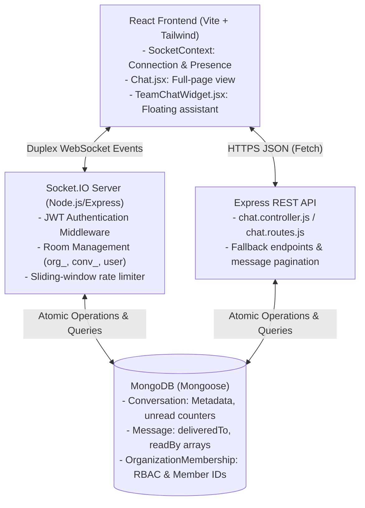
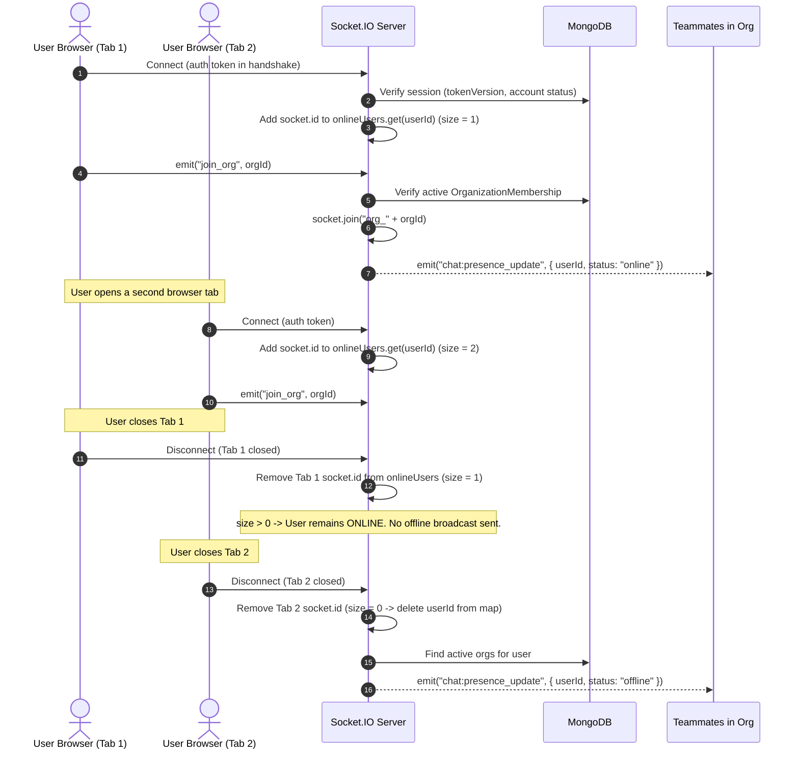
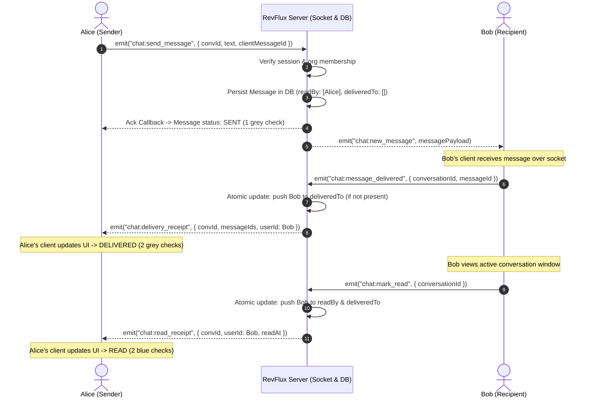

# RevFlux: Real-Time Presence & WhatsApp-Style Message Receipts

An end-to-end architectural guide, engineering reference, and educational walkthrough for the real-time presence and message delivery receipt system in RevFlux SaaS.

---

## 1. Why Socket.IO is Used Instead of Relying Only on HTTP

In modern SaaS applications, team communication demands low-latency, bidirectional, event-driven interactions. While HTTP (REST) is excellent for standard request-response operations (e.g., loading conversation history, pagination, profile settings), relying solely on HTTP for chat introduces severe bottlenecks:

| Communication Model | Latency | Server Load / Overhead | Real-Time Feasibility |
| :--- | :--- | :--- | :--- |
| **HTTP Short Polling** | 1–5 seconds | High (repeated TCP/TLS handshakes, headers, database queries) | Inefficient; creates unnecessary database thrashing |
| **HTTP Long Polling** | 100–500 ms | Moderate (hanging connections, frequent reconnection overhead) | Fragile under load; awkward state coordination |
| **Server-Sent Events (SSE)** | Low | Low (unidirectional server-to-client stream) | Lacks client-to-server upstream streaming without separate HTTP calls |
| **WebSockets (via Socket.IO)** | **< 10 ms** | **Extremely Low** (single persistent duplex connection per tab) | **Optimal** for bidirectional messaging, presence heartbeats, typing indicators, and delivery receipts |

### Why Socket.IO Over Plain WebSockets?
1. **Automatic Heartbeat & Reconnection**: Socket.IO automatically detects dropped connections, fires ping/pong heartbeats, and re-establishes socket sessions when network conditions recover.
2. **Built-in Multiplexing (Rooms & Namespaces)**: Enables isolating organization broadcasts (`org_${orgId}`), conversation rooms (`chat_conv_${convId}`), and private user rooms (`${userId}`).
3. **Transport Fallback**: Falls back to HTTP long-polling if restrictive corporate firewalls or proxies block raw WebSocket handshakes.
4. **Acknowledgement Callbacks**: Provides client-server request-reply semantics natively over the socket connection.

---

## 2. Architecture & Component Responsibilities

The real-time messaging pipeline is partitioned across four layers:



### Layer Responsibilities

1. **React Frontend (`SocketContext.jsx`, `Chat.jsx`, `TeamChatWidget.jsx`)**:
   - Manages socket connection lifecycle tied to authenticated user & active organization.
   - Dispatches user actions (`chat:send_message`, `chat:typing`, `chat:mark_read`, `chat:message_delivered`).
   - Renders presence dots (green for online, neutral slate for offline).
   - Renders WhatsApp-style checkmarks:
     - **1 Grey Check (`Check`)**: Message successfully persisted on the server.
     - **2 Grey Checks (`CheckCheck`)**: Acknowledged delivery by recipient browser.
     - **2 Blue Checks (`CheckCheck text-sky-400`)**: Read by recipient in an active chat window.

2. **Socket.IO Gateway (`backend/utils/socket.js`)**:
   - Authenticates connections via signed JWT (`verifySocketSession`).
   - Maintains in-memory multi-tab presence (`onlineUsers` Map of `Set<socketId>`).
   - Enforces sliding-window rate limiting (maximum 10 messages per 5 seconds).
   - Authorizes room entry based on MongoDB organization membership.
   - Broadcasts events to scoped conversation rooms and individual user rooms.

3. **Node.js / Express Controllers (`backend/controllers/chat.controller.js`)**:
   - Provides REST fallback endpoints for sending messages, fetching paginated history, and acknowledging delivery.
   - Triggers background email notifications via Resend for offline or unread recipients.
   - Enforces tenancy validation (`req.organization._id`) and participant checks.

4. **MongoDB Persistence (`Message.js`, `Conversation.js`, `OrganizationMembership.js`)**:
   - Persists messages and conversation unread counters.
   - Stores delivery and read receipts in atomic subdocument arrays (`deliveredTo` and `readBy`).
   - Guarantees data durability across client refreshes and reconnects.

---

## 3. Connection and Presence Lifecycle

Presence tracking is designed to be **accurate, lightweight, and tenant-scoped** without performing database writes on every socket heartbeat.



### Key Technical Details
- **Multi-Tab Support**: `onlineUsers` is a `Map<userId, Set<socketId>>`. A user only goes offline when their active socket set becomes empty (`size === 0`).
- **Initial Sync**: When a client connects or switches organizations, it emits `chat:get_online_teammates(orgId)`. The server filters the organization's active members against `onlineUsers` and returns the array of online user IDs in an acknowledgement callback.
- **Tenant Isolation**: When a user disconnects, the offline broadcast is emitted strictly to rooms named `org_${m.organization}` matching active memberships—preventing cross-tenant presence leaks.

---

## 4. Message Lifecycle: Sent, Delivered, and Read

Every message transitions through three deterministic states:



---

## 5. Files Changed & Why

| File | Responsibility & Changes Made |
| :--- | :--- |
| `backend/models/Message.js` | Added `deliveredTo: [deliveryReceiptSchema]` containing `{ user, deliveredAt }` alongside `readBy` to store per-recipient delivery timestamps. |
| `backend/utils/socket.js` | 1. Scoped `disconnect` presence broadcast strictly to active organizations.<br>2. Implemented `chat:message_delivered` socket handler with atomic `$push` into `deliveredTo` for recipients.<br>3. Updated `chat:mark_read` to update both `deliveredTo` and `readBy`.<br>4. Emits `chat:delivery_receipt` and `chat:read_receipt` to conversation rooms and personal user rooms. |
| `backend/controllers/chat.controller.js` | 1. Added REST endpoint `markAsDelivered` (`POST /api/chat/conversations/:id/delivered`).<br>2. Updated `markAsRead` to update both `deliveredTo` and `readBy` atomically.<br>3. Formatted and returned `deliveredTo` in `getMessages` and `sendMessage`. |
| `backend/routes/chat.routes.js` | Mounted `POST /conversations/:id/delivered` with authentication and organization scoping middleware. |
| `frontend/src/lib/services.js` | Added `markAsDelivered` to `chatApi`. |
| `frontend/src/pages/Chat.jsx` | 1. Added listener for `chat:delivery_receipt` to update message states.<br>2. Client automatically emits `chat:message_delivered` upon receiving `chat:new_message`.<br>3. Implemented WhatsApp-style checkmarks with accessible labels: Sent (1 grey check), Delivered (2 grey checks), Read (2 blue checks `text-sky-400`).<br>4. Added group chat read/delivered participant counters. |
| `frontend/src/components/common/TeamChatWidget.jsx` | 1. Added `chat:delivery_receipt` listener.<br>2. Fixed typo `other?.memberId` to `otherUser?.memberId`.<br>3. Updated checkmarks to support Sent, Delivered, and Read states matching the main Chat page. |
| `backend/tests/chat.test.js` | Added test cases 16 through 21 verifying presence, multi-tab presence, cross-tenant presence isolation, delivery receipts, idempotency, offline recovery, group tracking, and unauthorized access denial. |

---

## 6. Socket Event Names and Payload Shapes

### Client to Server Events

#### 1. `chat:send_message`
```typescript
interface SendMessagePayload {
  conversationId: string;
  text: string;
  clientMessageId?: string; // Optional UUID for idempotency
}
```

#### 2. `chat:message_delivered`
```typescript
interface MessageDeliveredPayload {
  conversationId: string;
  messageId?: string;       // Single message ID
  messageIds?: string[];    // Array of message IDs (batch delivery)
}
```

#### 3. `chat:mark_read`
```typescript
interface MarkReadPayload {
  conversationId: string;
}
```

#### 4. `chat:get_online_teammates`
```typescript
// Client sends orgId string; server responds via callback:
type Callback = (response: { success: boolean; onlineUserIds: string[] } | { error: string }) => void;
```

### Server to Client Events

#### 1. `chat:presence_update`
```typescript
interface PresenceUpdatePayload {
  userId: string;
  status: "online" | "offline";
}
```

#### 2. `chat:delivery_receipt`
```typescript
interface DeliveryReceiptPayload {
  conversationId: string;
  messageIds: string[];
  userId: string;         // Recipient who received the message
  deliveredAt: string;    // ISO timestamp
}
```

#### 3. `chat:read_receipt`
```typescript
interface ReadReceiptPayload {
  conversationId: string;
  userId: string;         // Recipient who opened the conversation
  readAt: string;         // ISO timestamp
}
```

#### 4. `chat:new_message`
```typescript
interface NewMessagePayload {
  id: string;
  conversationId: string;
  sender: {
    _id: string;
    name: string;
    avatar?: string;
    email: string;
    jobTitle?: string;
  };
  text: string;
  deliveredTo: Array<{ user: string; deliveredAt: string }>;
  readBy: Array<{ user: string; readAt: string }>;
  clientMessageId?: string;
  createdAt: string;
}
```

---

## 7. Authentication, Tenant Isolation, and Authorization

RevFlux enforces defense-in-depth across every Socket.IO and REST endpoint:

1. **Authentication Gate**: Every connection must provide a signed JWT in `socket.handshake.auth.token`. The server validates:
   - Secret key signature (`jwt.verify`).
   - `tokenVersion` matching `User.tokenVersion` (rejecting revoked sessions).
   - User account status (`active` vs `suspended` or `deactivated`).
2. **Tenant Isolation**: Sockets are bound to organizations via `join_org`. A user can only join `org_${orgId}` if an active `OrganizationMembership` document exists for that user and organization.
3. **Conversation Authorization**: Sockets can only join `chat_conv_${convId}` if:
   - The user is in `Conversation.participants`.
   - The user's active membership belongs to `Conversation.organization`.
4. **Receipt Ownership Integrity**: The server derives `userId` exclusively from the verified `socket.user._id` session. A client cannot mark messages delivered or read on behalf of another user (`sender: { $ne: socket.user._id }`).

---

## 8. Multi-Tab Presence & Reconnect Recovery

### Multi-Tab Tracking
```typescript
// In backend/utils/socket.js
const onlineUsers = new Map(); // userId -> Set<socketId>

// On connection:
if (!onlineUsers.has(userIdStr)) {
  onlineUsers.set(userIdStr, new Set());
}
onlineUsers.get(userIdStr).add(socket.id);

// On disconnect:
const userSockets = onlineUsers.get(userIdStr);
if (userSockets) {
  userSockets.delete(socket.id);
  if (userSockets.size === 0) {
    onlineUsers.delete(userIdStr);
    // Broadcast offline only when last tab closes!
  }
}
```

### Reconnect & Offline Recovery
If a user is offline when a teammate sends a message:
1. The message is persisted in MongoDB with `deliveredTo: []`.
2. When the offline user re-opens RevFlux, their browser connects and loads the conversation messages via REST (`GET /api/chat/conversations/:id/messages`).
3. The client receives the message array, identifies messages sent by teammates where the current user is not in `deliveredTo`, and automatically acknowledges delivery via `chat:message_delivered`.
4. The server atomically updates `deliveredTo` and broadcasts `chat:delivery_receipt` to the sender's active sockets.

---

## 9. Direct vs. Group Receipt Semantics

| State | Direct Conversation (1:1) | Group Conversation (3+ Users) |
| :--- | :--- | :--- |
| **SENT** | Persisted on server (1 grey check) | Persisted on server (1 grey check) |
| **DELIVERED** | Recipient client received message (2 grey checks) | At least 1 recipient received message (2 grey checks with count, e.g. `Delivered to 2 of 4`) |
| **READ** | Recipient viewed conversation (2 blue checks) | Read by all teammates (2 blue checks `Read by all`) or partial read (2 blue checks with count `Read by 2 of 4`) |

---

## 10. End-to-End Sequence Diagram

```
Alice (Sender)               RevFlux Server / MongoDB               Bob (Recipient)
      |                                  |                                  |
      |-- 1. emit("chat:send_message") ->|                                  |
      |   { text: "Deploy complete" }    |                                  |
      |                                  |-- 2. Validate session & rate     |
      |                                  |-- 3. Persist to MongoDB          |
      |<- 4. Ack callback (SENT: 1 check)|                                  |
      |                                  |-- 5. emit("chat:new_message") -->|
      |                                  |                                  |
      |                                  |<- 6. emit("chat:message_delivered")
      |                                  |-- 7. DB $push deliveredTo        |
      |<- 8. emit("chat:delivery_receipt")                                  |
      |   (DELIVERED: 2 grey checks)     |                                  |
      |                                  |                                  |
      |                                  |<- 9. emit("chat:mark_read") -----|
      |                                  |-- 10. DB $push readBy            |
      |<- 11. emit("chat:read_receipt") -|                                  |
      |   (READ: 2 blue checks)          |                                  |
```

---

## 11. Local Manual Testing Instructions

To manually test presence and message receipts using the QA personas:

### Personas
- **QA Owner**: `qa.owner@revflux.local` / `QAPassword123!`
- **QA Rep 1**: `qa.rep1@revflux.local` / `QAPassword123!`

### Procedure
1. Open an Incognito window in Chrome and log in as `qa.owner@revflux.local`.
2. Open a normal window (or Firefox) and log in as `qa.rep1@revflux.local`.
3. In Window 1 (Owner), navigate to `/chat`. Observe the green presence dot next to QA Rep 1 in the teammates list.
4. Close Window 2 (Rep 1). Within 2 seconds, observe the presence dot in Window 1 turn neutral slate (offline).
5. In Window 1, send a message to Rep 1: *"Are you available?"*.
   - Verify the message shows **1 grey checkmark** (Sent, but recipient offline).
6. Re-open Window 2 and log in as Rep 1.
   - Look at Window 1: As soon as Rep 1's browser loads, the checkmark transitions to **2 grey checkmarks** (Delivered).
7. In Window 2, click the conversation with QA Owner to open it.
   - Look at Window 1: The checkmarks turn **blue** (Read).
8. Open the floating `TeamChatWidget` in Window 2 and send a reply. Observe identical receipt progression in both views.

---

## 12. Common Failure Scenarios & Debugging

| Symptom | Probable Cause | How to Debug & Fix |
| :--- | :--- | :--- |
| **Checkmark stuck on 1 grey check (Sent)** | Recipient socket disconnected or recipient did not emit `chat:message_delivered`. | Check browser console in recipient window for WebSocket connection errors. Verify recipient is in `chat_conv_${convId}` room. |
| **User appears offline despite being logged in** | Socket failed JWT handshake (e.g., token expired or `tokenVersion` mismatch). | Inspect network tab WS connection. Look for `401 Not authorized, session has been revoked`. Log out and log in again. |
| **User shown online in other organizations** | Presence broadcast was emitted to a global room instead of `org_${orgId}`. | Verify `backend/utils/socket.js` only emits `chat:presence_update` to `org_${orgId}` rooms. |
| **Duplicate receipt entries in MongoDB** | Non-atomic `$push` without `$ne` filtering. | Ensure `Message.updateMany` query specifies `"deliveredTo.user": { $ne: userId }` and `"readBy.user": { $ne: userId }`. |

---

## 13. State Storage: MongoDB vs. In-Memory

| Data Element | Storage Location | Durability | Rationale |
| :--- | :--- | :--- | :--- |
| **Active Sockets (`onlineUsers`)** | In-Memory (`Map<userId, Set<socketId>>`) | Ephemeral (lost on server restart) | Fast lookup for heartbeats and multi-tab management without database I/O overhead. |
| **Rate Limit Window (`messageTimestamps`)** | In-Memory (`Map<userId, number[]>`) | Ephemeral | 5-second sliding window does not require persistent storage. |
| **Delivered Receipts (`deliveredTo`)** | MongoDB (`Message.deliveredTo`) | Permanent | Preserves audit trail and delivery state across reloads and multi-device sessions. |
| **Read Receipts (`readBy`)** | MongoDB (`Message.readBy`) | Permanent | Durable read status across sessions. |
| **Unread Counters (`unreadState`)** | MongoDB (`Conversation.unreadState`) | Permanent | Instant badge count rendering without full message aggregation. |

---

## 14. Remaining Limitations & Scaling Steps

1. **Multi-Node Cluster Scaling**:
   - Currently, `onlineUsers` is stored in process memory. In a multi-node horizontal deployment (e.g. multiple Render or Kubernetes instances), Socket.IO requires the `@socket.io/redis-adapter` or `@socket.io/redis-streams-adapter` so sockets across nodes can communicate.
   - Presence state across nodes should be managed with Redis Sets (`SADD`, `SREM`, `SCARD`).
2. **Database Migrations Required**:
   - None. The schema additions (`deliveredTo` on `Message`) use Mongoose default empty arrays and do not require destructive database alterations.
