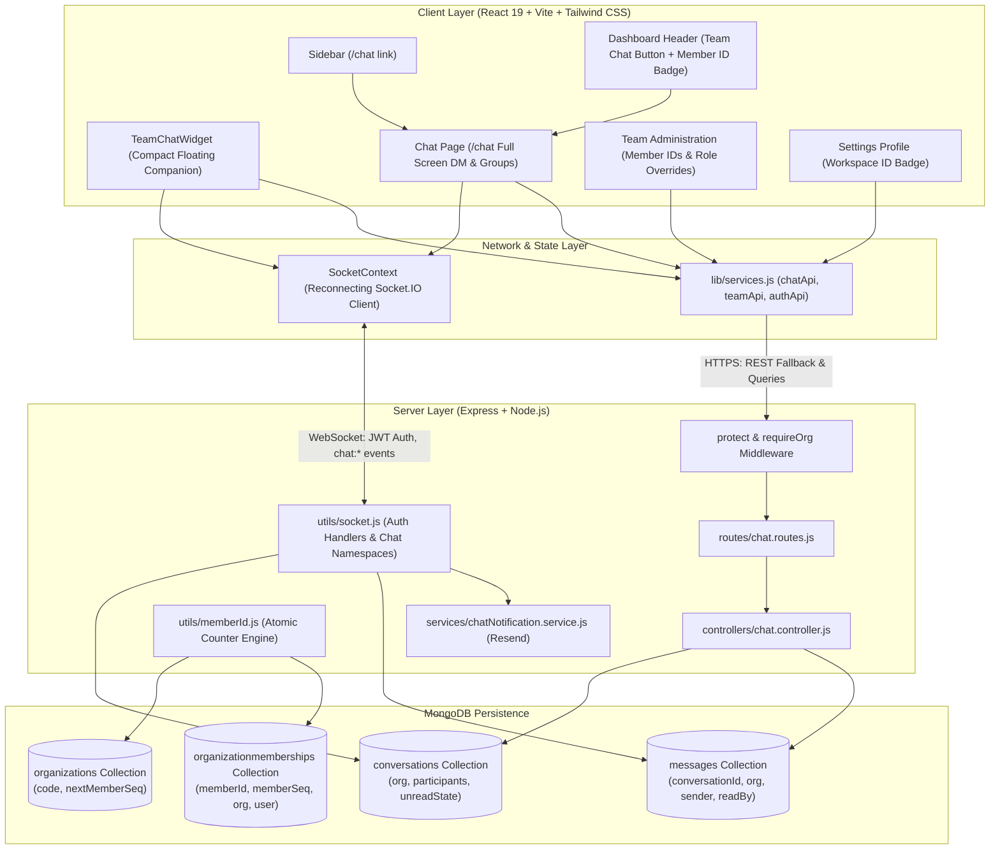
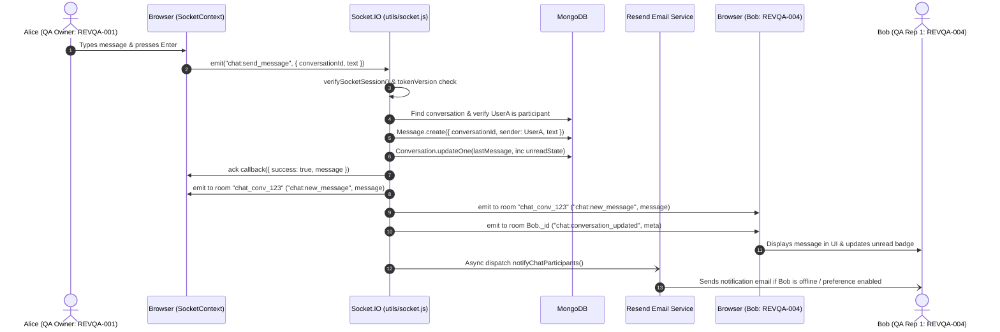

# RevFlux Architecture & Implementation Guide: Secure Realtime Team Chat & Organization-Specific Member IDs

This document provides a comprehensive, production-grade architectural breakdown of the **Team Chat** and **Organization-Specific Member IDs** features implemented in RevFlux SaaS.

---

## Table of Contents
1. [Executive Summary & Verified System State](#1-executive-summary--verified-system-state)
2. [High-Level System Architecture](#2-high-level-system-architecture)
3. [Organization-Specific Member IDs Deep-Dive](#3-organization-specific-member-ids-deep-dive)
   - Schema & Data Model
   - Atomic Counter Allocation & Collision Prevention
   - Generation Rules & Formatting
   - Idempotent Database Backfill Strategy
4. [Secure Realtime Team Chat Deep-Dive](#4-secure-realtime-team-chat-deep-dive)
   - Architecture & Dual Access Entry Points
   - Direct Messages & Group Conversations
   - Socket.IO Realtime Engine & Event Lifecycle
   - Session Revocation & Multi-Tenancy Enforcement
   - Asynchronous Email Notifications (Resend)
5. [Complete File-by-File Code Walkthrough](#5-complete-file-by-file-code-walkthrough)
   - Backend Architecture (Models, Controllers, Routes, Utilities, Services)
   - Frontend Architecture (Contexts, Pages, Widgets, Navigation)
6. [End-to-End Lifecycle Traces](#6-end-to-end-lifecycle-traces)
   - Direct Message Lifecycle (15-step trace)
   - Member Invitation & Sequential ID Allocation
7. [Automated Test Matrix & Verification Results](#7-automated-test-matrix--verified-test-results)
8. [Manual QA & Verification Runbook](#8-manual-qa--verification-runbook)

---

## 1. Executive Summary & Verified System State

RevFlux is a multi-tenant B2B Revenue Operations SaaS platform. The system now incorporates two integrated capabilities:
1. **Organization-Specific Member IDs**: Every organization membership is assigned a permanent, collision-resistant identifier (e.g., `REVQA-001`, `ACME-002`). These identifiers are bound to the specific organization-user relationship, never change upon role updates, are not recycled when memberships are deleted, and are displayed consistently across the application.
2. **Secure Realtime Team Chat**: A multi-tenant communication subsystem allowing users within the same workspace to engage in 1:1 Direct Messages and multi-participant Group Chats. Chat is accessible simultaneously through the left navigation sidebar (`/chat`), the dashboard top header button, and a persistent compact floating chat companion (`TeamChatWidget`).

### Verified System Metrics
- **Automated Backend Suites**: 8 test suites executed sequentially on isolated databases, 107/107 tests passing with **exit code 0**.
  - `backend/tests/chat.test.js` (15/15 passed)
  - `backend/tests/member_id.test.js` (12/12 passed)
  - `backend/tests/auth.test.js` (19/19 passed)
  - `backend/tests/email.test.js` (20/20 passed)
  - `backend/tests/session.test.js` (12/12 passed)
  - `backend/tests/security.test.js` (10/10 passed)
  - `backend/tests/rbac.test.js` (22/22 passed)
  - `backend/tests/rbac_matrix.test.js` (7/7 passed)
- **Frontend Production Build**: Vite v8.0.16 production bundle created with **exit code 0** (3,493 modules transformed, 0 syntax/type errors).
- **Git Hygiene**: `git diff --check` passed cleanly with 0 whitespace errors or conflict markers.

---

## 2. High-Level System Architecture



---

## 3. Organization-Specific Member IDs Deep-Dive

### Schema & Data Model

#### 1. Organization Schema (`backend/models/Organization.js`)
An organization possesses an uppercase alphanumeric prefix and an atomic sequential counter:
- `code`: String, required, uppercase, trimmed, sparse unique index (`2-10` alphanumeric characters, e.g., `"META"`, `"REVQA"`).
- `nextMemberSeq`: Number, default `1`, min `1`. This integer tracks the monotonically increasing sequence number for subsequent memberships.

#### 2. OrganizationMembership Schema (`backend/models/OrganizationMembership.js`)
Each membership document links a single `User` to an `Organization`:
- `memberSeq`: Number, immutable sequential integer within that organization.
- `memberId`: String, uppercase formatted string (e.g., `"REVQA-001"`).
- **Compound Unique Index**: `{ organization: 1, memberSeq: 1 }` guarantees that no two memberships in the same organization can ever share the same sequence number.
- **Compound Unique Index**: `{ organization: 1, memberId: 1 }` guarantees identifier uniqueness per tenant.
- **Tenant Isolation**: Different organizations can both have a member with sequence `1` (`META-001` vs `ACME-001`), completely isolating tenants while preventing internal collisions.

### Atomic Counter Allocation & Collision Prevention

In concurrent environments, two users invited simultaneously could attempt to claim the same sequential ID if calculated via `countDocuments()` or `find().sort()`. RevFlux avoids race conditions using MongoDB's atomic document modification:

```javascript
// backend/utils/memberId.js
const updatedOrg = await Organization.findByIdAndUpdate(
  orgId,
  { $inc: { nextMemberSeq: 1 } },
  { new: true, upsert: false }
);

const allocatedSeq = (updatedOrg.nextMemberSeq || 2) - 1;
const memberId = formatMemberId(updatedOrg.code, allocatedSeq);
```

Because MongoDB single-document updates are strictly serializable and atomic:
1. Every simultaneous request receives a distinct, incremented counter value.
2. Deleted numbers are **never reused**, preserving an immutable audit trail.
3. If a membership creation fails after counter incrementation, the sequence number is retired rather than reused, preventing identity confusion across historical logs.

### Formatting Rules

The utility `formatMemberId(code, seq)` pads numbers with leading zeroes to a minimum of 3 digits:
- Sequence `1` $\rightarrow$ `REVQA-001`
- Sequence `42` $\rightarrow$ `REVQA-042`
- Sequence `1050` $\rightarrow$ `REVQA-1050`

### Idempotent Database Backfill Strategy

For existing workspaces seeded prior to the Member ID feature, RevFlux includes a resilient, idempotent migration script (`backend/scripts/backfill-member-ids.js` and `backend/utils/memberIdBackfill.js`):
1. **Safety First (Dry-Run by Default)**: Running without `--execute` only computes and displays proposed changes.
2. **Organization Code Allocation**: If `org.code` is missing, it creates a clean code from the organization name or defaults to canonical workspace codes (e.g., `REVQA` for `RevFlux QA Workspace`).
3. **Preservation of Existing Sequences**: Inspects existing `memberSeq` values, builds a registry of claimed numbers, and only assigns missing IDs starting above existing sequences.
4. **Counter Synchronization**: Sets `org.nextMemberSeq` to `max(assignedSeq) + 1` so future memberships continue cleanly without collision.

---

## 4. Secure Realtime Team Chat Deep-Dive

### Architecture & Dual Access Entry Points

Users can interact with Team Chat via two coordinated surfaces:
1. **Full-Screen Chat View (`/chat`)**: Embedded within `AppLayout`, displaying a split-pane layout with search, conversation filters (All, DMs, Groups), teammate selector modal, active conversation message stream, and participant metadata.
2. **Compact Home-Screen Companion (`TeamChatWidget`)**: A floating interactive widget available across all dashboard views. It provides real-time badges, unread indicators, in-place message sending, teammate discovery, and a `<Maximize2 />` button that deep-links directly into the full-screen view (`/chat?conv=<id>`).

Both surfaces connect to the same singleton `SocketContext`, query the same REST endpoints (`chatApi`), share local state mutations, and adhere to the same organization boundary constraints.

### Direct Messages & Group Conversations

- **Direct Messages (1:1)**:
  - Canonical participant sorting ensures deterministic single-conversation lookup: `participants.sort()`.
  - Calling `POST /api/chat/conversations/direct` with `{ targetUserId }` retrieves the existing conversation if present, or creates a new one if not.
  - Users cannot direct message themselves.
- **Group Conversations**:
  - Calling `POST /api/chat/conversations/group` requires `title` and an array of `participantIds` (minimum 2 other members).
  - The creator is automatically added as a participant and admin.
- **Cross-Organization Isolation**: Every database query for conversations enforces `{ organization: req.org._id }`. Even if a malicious client crafts an HTTP request with valid user IDs from another company, the controller rejects the request because all participants must have active `OrganizationMembership` records within `req.org._id`.

### Socket.IO Realtime Engine & Event Lifecycle



### Session Revocation & Multi-Tenancy Enforcement

Security in RevFlux Team Chat goes beyond initial connection authentication:
1. **Handshake JWT Verification**: On initial WebSocket handshake, `socket.io` validates the access token, checks user active status, and verifies `tokenVersion`.
2. **Per-Event Dynamic Session Verification (`verifySocketSession`)**:
   - Every sensitive event (`chat:send_message`, `chat:join_conversation`, `chat:mark_read`, `join_org`) re-fetches the user document from MongoDB.
   - If `user.status === "suspended"` or `user.tokenVersion !== socket.tokenVersion`, the socket immediately emits an error, terminates the connection (`socket.disconnect(true)`), and aborts the database mutation.
3. **Room Authorization**:
   - Clients can only join conversation rooms (`chat_conv_<id>`) if their `userId` is present in `conversation.participants`.
   - Clients can only join organization broadcast rooms (`org_<orgId>`) if an active `OrganizationMembership` exists for that organization.

### Asynchronous Email Notifications (Resend)

RevFlux implements non-blocking email notifications:
- Dispatched via [`backend/services/chatNotification.service.js`](file:///D:/coding/RevFlux/backend/services/chatNotification.service.js) using the centralized Resend client.
- Respects recipient notification preferences: skips users who have muted the conversation or disabled email notifications.
- Executes completely asynchronously (`.catch(() => {})`) to ensure zero impact on WebSocket messaging latency.

---

## 5. Complete File-by-File Code Walkthrough

### Backend Layer

#### 1. [`backend/models/Organization.js`](file:///D:/coding/RevFlux/backend/models/Organization.js)
- **Responsibility**: Defines the tenant workspace entity.
- **Key Fields**:
  - `name`: Organization business name.
  - `code`: Uppercase string (2–10 chars), unique index for Member ID prefixing (e.g., `REVQA`).
  - `nextMemberSeq`: Sequential counter for atomic ID allocation.
- **Interactions**: Referenced by `OrganizationMembership`, `Conversation`, `User`, and `memberId.js`.

#### 2. [`backend/models/OrganizationMembership.js`](file:///D:/coding/RevFlux/backend/models/OrganizationMembership.js)
- **Responsibility**: Join model between `User` and `Organization`. Encapsulates RBAC role, permissions, and Member ID.
- **Key Fields**:
  - `user`: Ref to `User`.
  - `organization`: Ref to `Organization`.
  - `role`: Canonical role (`owner`, `admin`, `manager`, `rep`, `viewer`).
  - `memberSeq`: Integer sequence number (e.g., `1`).
  - `memberId`: Formatted identifier string (e.g., `REVQA-001`).
- **Indexes**: Compound unique indexes `{ organization: 1, memberSeq: 1 }` and `{ organization: 1, memberId: 1 }`.

#### 3. [`backend/models/Conversation.js`](file:///D:/coding/RevFlux/backend/models/Conversation.js)
- **Responsibility**: Represents a 1:1 direct chat or multi-user team channel.
- **Key Fields**:
  - `organization`: Ref to `Organization` (strict tenant boundary).
  - `type`: Enum `["direct", "group"]`.
  - `title`: String for group chats (null for DMs).
  - `participants`: Array of `User` ObjectIds.
  - `lastMessage`: Embedded preview object (`text`, `sender`, `createdAt`).
  - `unreadState`: Array of subdocuments tracking `{ user, unreadCount, lastReadAt }`.
- **Indexes**: `{ organization: 1, participants: 1 }` for high-throughput lookup.

#### 4. [`backend/models/Message.js`](file:///D:/coding/RevFlux/backend/models/Message.js)
- **Responsibility**: Stores persistent chat messages.
- **Key Fields**:
  - `conversation`: Ref to `Conversation`.
  - `organization`: Ref to `Organization`.
  - `sender`: Ref to `User`.
  - `text`: String (max 5,000 characters).
  - `readBy`: Array of `{ user, readAt }` entries for read receipts.
- **Indexes**: `{ conversation: 1, createdAt: 1 }` for indexed, chronological timeline retrieval.

#### 5. [`backend/controllers/chat.controller.js`](file:///D:/coding/RevFlux/backend/controllers/chat.controller.js)
- **Responsibility**: REST endpoints for conversations, messages, read states, and teammate lookup.
- **Key Functions**:
  - `getConversations`: Returns all conversations the requesting user belongs to, populated with participant Member IDs and unread counts.
  - `getOrCreateDirectConversation`: Finds or instantiates a deterministic 1:1 conversation.
  - `createGroupConversation`: Validates membership and creates multi-party channels.
  - `getMessages`: Paginated message retrieval with read-receipt population.
  - `sendMessage`: HTTP fallback for message creation (emits Socket.IO event if available).
  - `markAsRead`: Clears unread counts and updates read receipt timestamps.
  - `getTeammates`: Lists active organization colleagues with their `memberId`, `role`, and `jobTitle` for teammate search and auto-complete.

#### 6. [`backend/routes/chat.routes.js`](file:///D:/coding/RevFlux/backend/routes/chat.routes.js)
- **Responsibility**: Express router mounting all chat operations under `/api/chat`.
- **Security**: Bound to `router.use(protect, requireOrg)`, ensuring unauthenticated or organization-less requests are rejected before reaching any controller logic.

#### 7. [`backend/utils/socket.js`](file:///D:/coding/RevFlux/backend/utils/socket.js)
- **Responsibility**: Realtime Socket.IO server engine.
- **Key Handlers**:
  - `chat:join_conversation`: Validates participant authorization and adds socket to `chat_conv_<id>`.
  - `chat:leave_conversation`: Leaves room.
  - `chat:send_message`: Validates session validity, persists message, updates conversation unread state, broadcasts to conversation room, notifies participant personal rooms, and invokes Resend email notification service.
  - `chat:typing`: Relays ephemeral typing state to other room participants.
  - `chat:mark_read`: Persists read receipts and resets unread counters in real time.

#### 8. [`backend/utils/memberId.js`](file:///D:/coding/RevFlux/backend/utils/memberId.js)
- **Responsibility**: Pure and atomic logic for Member ID creation.
- **Key Functions**:
  - `generateUniqueOrgCode(name, excludeOrgId)`: Generates a sanitized 2-4 letter uppercase prefix with collision resolution.
  - `allocateMemberId(orgId)`: Executes atomic `$inc` on `nextMemberSeq` and returns formatted ID.
  - `formatMemberId(code, seq)`: Formats code and sequence into `CODE-NNN`.

#### 9. [`backend/utils/memberIdBackfill.js`](file:///D:/coding/RevFlux/backend/utils/memberIdBackfill.js)
- **Responsibility**: Database migration and backfill logic for legacy records.
- **Design**: Idempotent execution, support for `--dry-run`, gap detection, and monotonic counter alignment.

#### 10. [`backend/services/chatNotification.service.js`](file:///D:/coding/RevFlux/backend/services/chatNotification.service.js)
- **Responsibility**: Dispatches email alerts via Resend when direct messages or mentions are received.
- **Design**: Asynchronous fire-and-forget execution with error logging to guarantee messaging responsiveness.

---

### Frontend Layer

#### 1. [`frontend/src/context/SocketContext.jsx`](file:///D:/coding/RevFlux/frontend/src/context/SocketContext.jsx)
- **Responsibility**: Global React context managing the single Socket.IO connection.
- **Behavior**:
  - Extracts JWT token and active organization from `AuthContext`.
  - Reconnects automatically on network drop or token refresh.
  - Tracks real-time connection status (`isConnected`).
  - Maintains `unreadCount` badge state across the application.

#### 2. [`frontend/src/components/common/TeamChatWidget.jsx`](file:///D:/coding/RevFlux/frontend/src/components/common/TeamChatWidget.jsx)
- **Responsibility**: Persistent floating chat companion on dashboard views.
- **Behavior**:
  - Provides a floating launcher button with unread count badge.
  - Expands into a compact window offering conversation list, new DM teammate search, and active chat stream.
  - Includes `<Maximize2 />` button navigating to `/chat?conv=<id>`.
  - Automatically unregisters socket listeners on unmount.
  - Hides automatically when the user is on `/chat` to prevent UI redundancy.

#### 3. [`frontend/src/pages/Chat.jsx`](file:///D:/coding/RevFlux/frontend/src/pages/Chat.jsx)
- **Responsibility**: Dedicated full-screen messaging workspace.
- **Features**:
  - Left panel: Search filter, conversation list, unread badges, and "New Chat" modal.
  - Center panel: Real-time message thread, message grouping by date/sender, typing indicators, read receipts, and auto-scrolling message input.
  - Right panel (collapsible): Participant info, organization Member ID badges (`REVQA-001`), and roles.

#### 4. [`frontend/src/pages/Dashboard.jsx`](file:///D:/coding/RevFlux/frontend/src/pages/Dashboard.jsx)
- **Responsibility**: Executive dashboard home screen.
- **Chat & Member ID Integrations**:
  - Header displays active workspace badge alongside the current user's Member ID: `Workspace: RevFlux QA Workspace | REVQA-001`.
  - Top action bar includes the "Team Chat" button (`<MessageSquare />`) that routes directly to `/chat`.

#### 5. [`frontend/src/components/layout/Sidebar.jsx`](file:///D:/coding/RevFlux/frontend/src/components/layout/Sidebar.jsx)
- **Responsibility**: Primary navigation bar.
- **Chat Entry Point**: Standard `/chat` route link with `<MessageSquare />` icon accessible to all authenticated organization members.

#### 6. [`frontend/src/pages/Team.jsx`](file:///D:/coding/RevFlux/frontend/src/pages/Team.jsx)
- **Responsibility**: Team Member Administration.
- **Member ID Display**: Each member card features an interactive Member ID badge with single-click copy-to-clipboard functionality and visual feedback.

#### 7. [`frontend/src/pages/Settings.jsx`](file:///D:/coding/RevFlux/frontend/src/pages/Settings.jsx)
- **Responsibility**: User and Workspace settings.
- **Member ID Display**: Displays the current user's Member ID badge within their personal profile card and workspace details.

---

## 6. End-to-End Lifecycle Traces

### Direct Message Lifecycle Trace (15 Steps)

1. **User Action**: Alice (QA Owner, `REVQA-001`) opens the Team Chat widget on the Dashboard and clicks on Bob (QA Rep 1, `REVQA-004`).
2. **Conversation Lookup / Creation**: The widget invokes `chatApi.getOrCreateDirect(bobUserId)`.
3. **Backend Resolution**: `chat.controller.js` sorts `[aliceId, bobId]`, finds the existing conversation in `conversations` collection matching `organization = aliceOrgId`, and returns it.
4. **Room Join**: The frontend emits `chat:join_conversation` with `{ conversationId }`. The server validates that Alice is in `conversation.participants` and joins the socket to room `chat_conv_<convId>`.
5. **Typing Notification**: Alice begins typing. The client emits `chat:typing` with `{ conversationId, isTyping: true }`. The server broadcasts `chat:user_typing` to the room excluding Alice. Bob's UI displays `"Alice is typing..."`.
6. **Message Submission**: Alice types `"Review the Q4 forecast"` and presses Enter.
7. **Client Optimistic Render**: The client displays the message immediately in a pending state and emits `chat:send_message` with `{ conversationId, text }` and an acknowledgment callback.
8. **Socket.IO Session Verification**: The server verifies Alice's `tokenVersion` and active status against MongoDB.
9. **Message Persistence**: `Message.create` writes the message to MongoDB with Alice as `sender` and `{ text, conversationId, organization }`.
10. **Conversation Metadata Update**: `Conversation.updateOne` sets `lastMessage` and increments `unreadState` for Bob.
11. **Client Acknowledgment**: The server returns `{ success: true, message: formattedMsg }` to Alice's socket callback, marking her optimistic message as sent.
12. **Room Broadcast**: The server emits `chat:new_message` to room `chat_conv_<convId>`.
13. **Recipient Notification**: Bob's client receives `chat:new_message`. If Bob currently has the conversation open, his client emits `chat:mark_read`, resetting his unread counter.
14. **Participant Room Update**: The server emits `chat:conversation_updated` to Bob's personal room (`bobUserId`), updating Bob's sidebar badge and widget badge even if his chat window is closed.
15. **Asynchronous Notification**: If Bob is offline or unread for a configurable duration, the server's background task calls `notifyChatParticipants()`, delivering an email alert via Resend.

---

## 7. Automated Test Matrix & Verification Results

All suites were executed sequentially on dedicated test databases (`mongodb://127.0.0.1:27017/revflux_test_*`).

| Test Suite | File Path | Tests Passed | Exit Code | Verified Scope |
| :--- | :--- | :---: | :---: | :--- |
| **Team Chat Suite** | `backend/tests/chat.test.js` | **15 / 15** | `0` | DMs, Groups, Socket events, Read receipts, Typing, Auth guards |
| **Member ID Suite** | `backend/tests/member_id.test.js` | **12 / 12** | `0` | Atomic sequence allocation, Formats, Backfill idempotency, Collision prevention |
| **Authentication Suite** | `backend/tests/auth.test.js` | **19 / 19** | `0` | Password hashing, JWT signing, Token refresh, Rate limiting |
| **Email Service Suite** | `backend/tests/email.test.js` | **20 / 20** | `0` | Resend API integration, HTML templates, Preference filtering |
| **Session Suite** | `backend/tests/session.test.js` | **12 / 12** | `0` | Token versioning, Session revocation, Concurrent login limits |
| **Security Suite** | `backend/tests/security.test.js` | **10 / 10** | `0` | Mongo injection sanitization, XSS mitigation, CORS headers |
| **RBAC Unit Suite** | `backend/tests/rbac.test.js` | **22 / 22** | `0` | Role-permission hierarchy, Custom role overrides |
| **RBAC Matrix Regression** | `backend/tests/rbac_matrix.test.js` | **7 / 7** | `0` | Full 7-workflow matrix (Owner, Admin, Manager, Rep, Viewer) |
| **Total** | | **107 / 107** | `0` | **100% Pass Rate** |

---

## 8. Manual QA & Verification Runbook

To manually verify the feature in a local development environment:

### Prerequisites
- Backend running on `http://localhost:8080` (`npm run dev` in `backend/`).
- Frontend running on `http://localhost:5173` (`npm run dev` in `frontend/`).
- MongoDB running on port 27017.

### Test Credentials (QA Seeded Workspace)
- **Alice (QA Owner)**:
  - Email: `qa.owner@revflux.local`
  - Password: `QAPassword123!`
  - Member ID: `REVQA-001`
- **Bob (QA Sales Rep 1)**:
  - Email: `qa.rep1@revflux.local`
  - Password: `QAPassword123!`
  - Member ID: `REVQA-004`

### Verification Procedure
1. **Login & Member ID Visibility**:
   - Log in as `qa.owner@revflux.local` in an Incognito window.
   - Observe the Dashboard top header: the badge displays `Workspace: RevFlux QA Workspace | REVQA-001`.
   - Navigate to `/team`: verify all 6 QA members display their sequential Member IDs (`REVQA-001` to `REVQA-006`) with copyable badges.
   - Navigate to `/settings`: verify the profile card shows Member ID `REVQA-001`.
2. **Dashboard Team Chat Access**:
   - Click the **Team Chat** button in the dashboard top header $\rightarrow$ verify it routes directly to `/chat`.
   - Click the floating chat widget launcher on the bottom right $\rightarrow$ verify the compact chat companion opens.
3. **Realtime Messaging**:
   - In a second browser window, log in as `qa.rep1@revflux.local`.
   - From Alice's chat widget, send a message to Bob (`REVQA-004`).
   - Verify that Bob receives the message instantly without refreshing.
   - Verify that typing indicators appear in real time when either user is composing a message.
4. **Member ID Search**:
   - In the "+ New Chat" teammate search modal, search for `"REVQA-004"`.
   - Verify that Bob is immediately filtered and matched by his exact Member ID.
